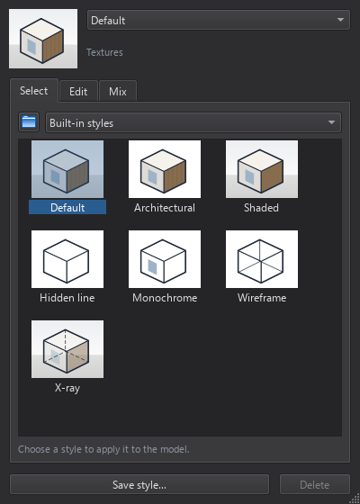
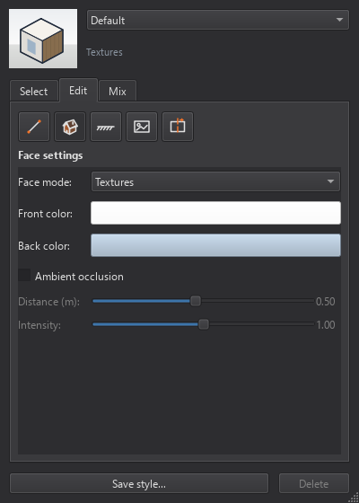
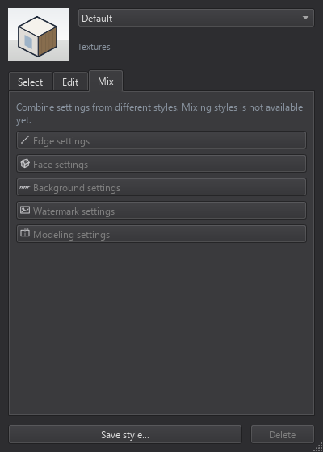
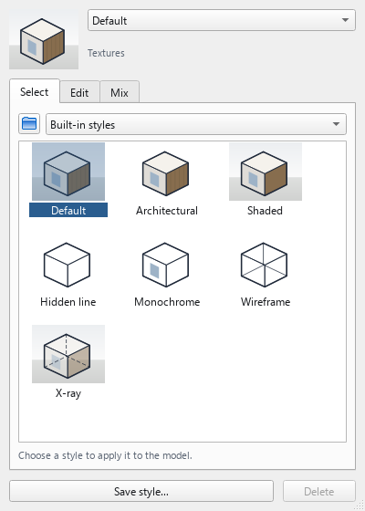

## Styles window: browse collections and edit by category

I would like to propose a dedicated Styles window that stays open while working in the model. The current toolbar dropdown is useful for quick changes, but closes when returning to the viewport. Keeping the editor visible would make it easier to adjust a look, inspect the model and continue editing.

A working Qt prototype opens from the existing Styles button. It can be resized, moved and closed, then reopened with the same editor state. A small sample and the current style name remain visible above three tabs:

- **Select** browses two collections: **Built-in styles** and **My styles**. Existing presets and saved styles appear as thumbnails. Choosing one applies it to the model; the existing Save style and Delete actions remain available.
- **Edit** groups settings under five icon buttons: **Edges, Faces, Background, Watermarks and Modeling**. Each category also displays its title, so the icons are not the only way to identify it.
- **Mix** reserves a place for combining categories from different styles in a later step.

The first implementation reorganizes the existing style controls: face modes, front and back colors, edges and profiles, sky and ground colors, section fill, and ambient occlusion with its distance and intensity. Changes still appear directly in the viewport.

**Watermarks and style mixing are not implemented in this prototype.** Their pages clearly indicate this. No additional rendering features are included in this first step.

The layout uses IngeTrazo's Qt widgets, existing icons, accent colors and light/dark themes. The attached images show the IngeTrazo prototype itself. The proposal text, images and implementation are offered under **GPL-3.0-or-later**.

I would welcome feedback on the persistent window, collection browser and category organization before developing more options. After discussion, the plan would be one focused PR for the UI foundation, followed by separate, tested PRs for agreed additions.

### Demonstration

[Watch the Styles window demo](https://youtu.be/S3uujX5ecAo)

### Screenshots

